<picture>
  <source media="(prefers-color-scheme: dark)" srcset="./assets/header-dark.svg">
  
</picture>

 

 

We are **Smart Innova** — a software studio building the systems behind everyday operations: utility billing, inventory, HR & payroll, banking integrations and, now, **Binam.az**, a mobile-first building management app.

 

<picture>
  <source media="(prefers-color-scheme: dark)" srcset="./assets/solutions-dark.svg">
  
</picture>

  

<picture>
  <source media="(prefers-color-scheme: dark)" srcset="./assets/featured-dark.svg">
  
</picture>

  

<picture>
  <source media="(prefers-color-scheme: dark)" srcset="./assets/stack-dark.svg">
  
</picture>

  

<picture>
  <source media="(prefers-color-scheme: dark)" srcset="./assets/principles-dark.svg">
  
</picture>

 

### Let's build something together

Most of our work runs inside client infrastructure, so our repositories are private. 
For demos, partnerships or a project — reach out on <a href="https://www.instagram.com/binam.az_/">Instagram</a>.

 

<picture>
  <source media="(prefers-color-scheme: dark)" srcset="./assets/footer-dark.svg">
  
</picture>

